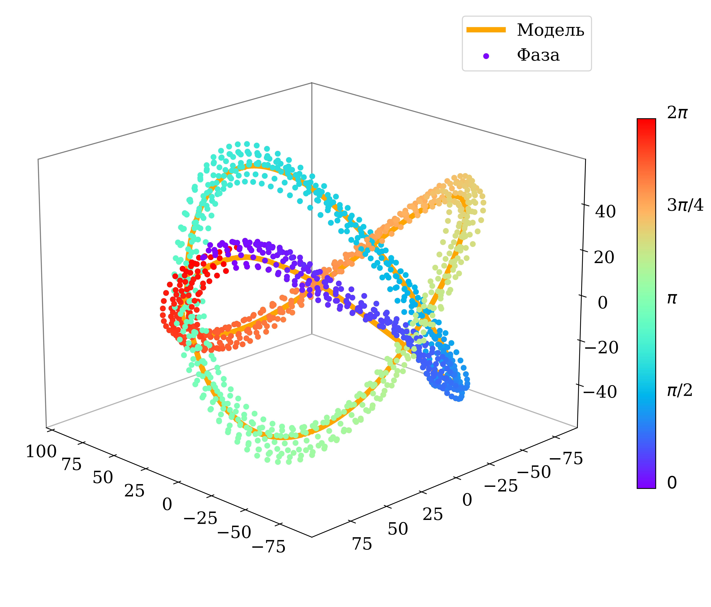

# project_phase_reg

**Автор**: Курдюкова А.Д.

**Эксперт**: Стрижов В.В.

**Консультанты**: Кормаков Г.В., Тихонов Д.М.

  Решается задача восстановления фазы квазипериодических сигналов движения человека. Эти сигналы имеют повторяющиеся значения без явной периодичности. Предлагается алгоритм определения фазы движения. Он основан на представлении исходного временного ряда в фазовом пространстве. Строится траекторная матрица временного ряда. Предлагается критерий выбора оптимальной размерности траекторного пространства. Значения фазы присваиваются в соответствии с близостью точек временного ряда к аппроксимирующей модели. Результаты работы алгоритма демонстрируется на сигналах, полученных с трехосевого акселерометра. Используются пять классов периодического движения человека. Для анализа качества работы алгоритм сравнивается с методом, использующим максимумы автокорелляционной функции.

[Назначение ноутбуков и запуск](code/main/README.md). Ноутбуки запускаются вручную из `code/main/`; результаты сохраняются в них же. Алгоритм Delay Embedding Phase Identifier разобран в [07_paper_algorithm.ipynb](code/main/07_paper_algorithm.ipynb).
